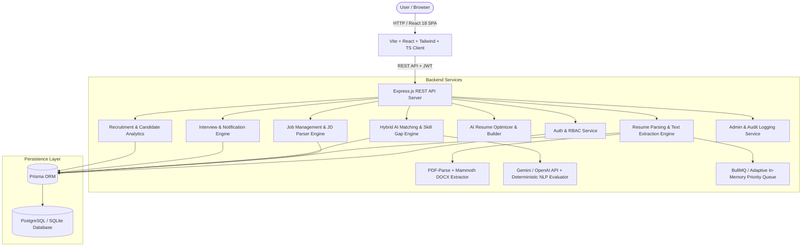

# JOBZY — Complete AI-Powered Talent Intelligence & Recruitment Platform

<div align="center">
  <h3>"Find your fit. Own your future."</h3>
  <p>Two-sided AI-driven recruitment ecosystem connecting candidates and recruiters through resume intelligence, job compatibility scoring, skill gap detection, and automated candidate ranking.</p>
</div>

---

## 🌟 Executive Overview

**JOBZY** is a production-quality, two-sided recruitment SaaS platform engineered to solve the core inefficiencies of modern technical hiring:
- **For Candidates**: Provides intelligent multi-format resume parsing (PDF, DOCX, TXT), deterministic ATS formatting audits, weighted compatibility scoring, AI bullet point rewriting, ATS-compliant resume builder, and job tracking with live interview scheduling.
- **For Recruiters**: Enables asynchronous batch resume screening (up to 50 resumes per batch), automated explainable candidate ranking, side-by-side comparison matrices (up to 5 candidates), interview scheduling with video rooms, and conversion funnel analytics.
- **For Administrators**: Real-time infrastructure telemetry, user RBAC management, and audit logging.

Built following the **Black & Lime — Bold Startup** aesthetic:
- **Primary Black**: `#000000`
- **Charcoal**: `#111111`
- **Electric Lime**: `#C4F167`
- **Soft Lime**: `#E0FE9E`
- **Typography**: Inter Sans

---

## 🏗️ Architecture & Technology Stack



### Frontend
- **Framework**: React 18, Vite, TypeScript
- **Styling**: Tailwind CSS, Custom Design System (`#000000` / `#C4F167`)
- **Icons**: Lucide React
- **Routing**: React Router DOM v6
- **Charts & Visualizations**: Recharts (Recruitment funnel, score distributions, skill demand)
- **Forms & Validation**: Zod, controlled state forms

### Backend
- **Runtime**: Node.js v22, Express.js, TypeScript
- **Database ORM**: Prisma ORM (20 normalized relational models)
- **Database**: SQLite default for instant zero-setup local execution; PostgreSQL + pgvector supported for production
- **Document Processing**: `pdf-parse` (PDFs), `mammoth` (DOCX), UTF-8 text parser
- **Security**: JWT Authentication, Bcrypt password hashing, Role-Based Access Control (RBAC)
- **Background Processing**: Adaptive in-memory priority queue with BullMQ / Redis compatibility

---

## 🔑 Pre-Seeded Demo Accounts (1-Click Login Ready)

The database includes rich, real-world data ready for immediate testing:

| Persona | Email | Password | Primary Features |
| :--- | :--- | :--- | :--- |
| **Candidate** | `candidate@jobzy.ai` | `password123` | Alex Rivera (Sr. Full-Stack Engineer): 94.2% match score, ATS analyzer, AI bullet rewriter, application tracker. |
| **Recruiter** | `recruiter@jobzy.ai` | `password123` | Sarah Chen (TechVanguard Lead Recruiter): Pipeline funnel, batch screening, leaderboard ranking, candidate comparison. |
| **Admin** | `admin@jobzy.ai` | `password123` | Elena Vance: Platform telemetry, user management, system audit logs. |

---

## 🚀 Quick Start Guide (Local Development)

### Prerequisites
- Node.js >= 18 (Tested on Node 22)
- npm >= 9

### 1. Installation
Clone repository and install dependencies:
```bash
# Clone
cd Jobzy

# Install backend dependencies
cd server && npm install

# Install frontend dependencies
cd ../client && npm install
```

### 2. Database Setup & Seeding
JOBZY uses Prisma ORM with SQLite out of the box for zero-dependency execution:
```bash
cd server

# Initialize database schema
npx prisma db push

# Generate Prisma Client
npx prisma generate

# Populate database with realistic candidates, jobs, matches, and skills
npm run prisma:seed
```

### 3. Launch Development Servers
Run the backend and frontend simultaneously:

**Terminal 1 (Backend API - Port 5001):**
```bash
cd server
npm run dev
```

**Terminal 2 (Frontend Client - Port 5173):**
```bash
cd client
npm run dev
```

Open your browser at **`http://localhost:5173`**.

---

## 🧪 Running System Test Suite

JOBZY includes an automated end-to-end integration test suite verifying persistence, resume extraction, timeline overlap calculation, weighted scoring, and AI bullet point transformation:

```bash
cd server
npx tsx src/tests/system.test.ts
```
Expected output:
```
===========================================
🎉 TEST SUITE COMPLETE: 22 Passed, 0 Failed
===========================================
```

---

## 📊 Core Feature Matrix

### Candidate Portal
1. **Candidate Dashboard**: Real-time stats (Applications, Under Review, Shortlisted, Interviews, Offers), ATS score health, verified skills cloud, and personalized job recommendations.
2. **Resume Management**: Upload PDF and DOCX documents with instant text extraction, structured JSON parsing, and delete/inspect actions.
3. **Resume Analyzer & ATS Checker**: Evaluates job compatibility (0-100%), displays category breakdowns, identifies missing mandatory vs. preferred skills, and generates tailored learning roadmaps.
4. **AI Resume Optimizer**: Interactive bullet point transformer using strong action verbs and metrics with side-by-side comparison, plus executive summary optimizer.
5. **ATS Resume Builder**: Live A4 resume preview with section editing, template switching, and print/PDF export.
6. **Job Discovery**: Faceted search with keyword filtering, remote toggle, employment types, match score badges, and 1-click apply modal.
7. **My Applications**: Visual stage pipeline (`Applied` -> `Under Review` -> `Shortlisted` -> `Interview` -> `Offer` -> `Hired`), interview room links, and status change audit logs.

### Recruiter Portal
1. **Recruiter Hub**: Key performance metrics, recruitment funnel (Recharts), applicant compatibility distribution, and recent applications.
2. **Requisition Management**: Job opening management with status toggles (`Published` / `Closed`), applicant counts, and direct links to ranked talent.
3. **AI Job Description Extractor**: Paste raw unstructured job descriptions to automatically extract required/preferred skills, seniority, and responsibilities.
4. **Bulk Resume Screening**: Drop up to 50 resumes per batch. Monitored via asynchronous background task queue with real-time progress percentages.
5. **Candidate Ranking Leaderboard**: Weighted multi-factor candidate scoring with sorting by score, experience, or skills, and multi-select for comparison.
6. **Side-by-Side Comparison Matrix**: Compare up to 5 candidates side-by-side across scores, non-overlapping experience, project complexity, and gaps.
7. **Interview Management**: Schedule technical architecture rounds, generate video meeting links, and record rubrics with 1-5 star ratings.
8. **Recruiter Analytics**: Funnel conversion, talent distribution, and in-demand skills visualization.

---

## 🐳 Production Deployment (Docker Compose)

JOBZY includes a complete production multi-container setup with PostgreSQL (with `pgvector`), Redis, Node.js API, and Nginx:

```bash
docker-compose up --build -d
```

Services started:
- `jobzy-postgres`: PostgreSQL 16 with pgvector on port `5432`
- `jobzy-redis`: Redis 7 on port `6379`
- `jobzy-server`: Production Node API on port `5001`
- `jobzy-client`: High-performance Nginx web server on port `5173` (mapped to `80`)

---

## 🔒 Security & Privacy

- **Explainable Decisions**: AI matching produces explicit, human-readable evidence. No candidate is rejected automatically solely by AI.
- **Non-Discriminatory Matching**: Candidate ranking evaluates verified technical skills, project architecture, and non-overlapping professional duration. Demographic attributes are excluded from score calculations.
- **RBAC Enforcement**: All candidate, recruiter, and administrator endpoints are protected via signed JWT tokens and verified role middleware.
- **Audit Trails**: Security actions, status transitions, and role modifications are logged to the `AuditLog` table.

---

## 📄 License
This project is proprietary software developed for the JOBZY Talent Intelligence Platform. All rights reserved.
